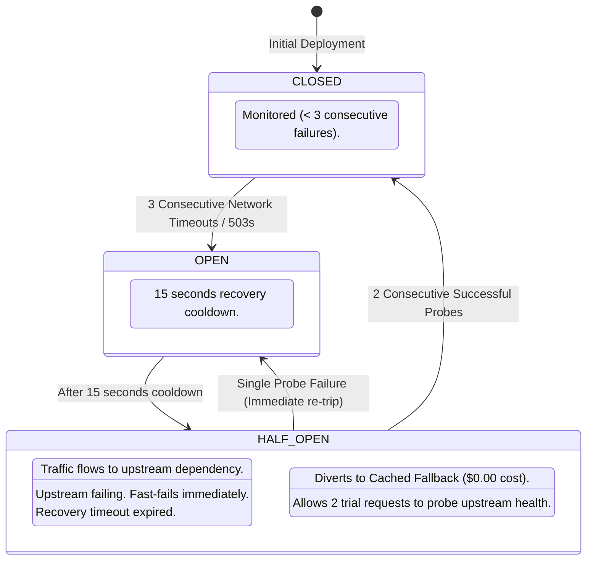

# Reliability, Resilience & Disaster Recovery Architecture
## Project: KAN-Edge POS Analytics (Edge-Optimized POS Analytics)
**Document Version:** 1.0.0  
**Status:** Approved Engineering Specification  
**Classification:** Enterprise SRE, DevOps & Production Operations  

---

## 1. Executive Summary & Reliability Philosophy

Point-of-Sale (POS) cash registers are the revenue backbone of physical commerce. An outage, screen stutter, or database corruption during peak checkout hours directly damages revenue and customer trust.

The **KAN-Edge Resilience Framework** ensures that the introduction of edge artificial intelligence never introduces a single point of failure (SPOF) to the POS checkout system. It is architectured around three tiers of defense:
1. **The Edge Defensive Ring:** Microsecond-level circuit breakers, token-bucket rate limiters, idempotency deduplication, and feature kill switches.
2. **The Data Durability Ring:** Non-blocking SQLite Write-Ahead Logging (WAL), automated online hot backups, SHA-256 integrity verification, and mandatory restore drills.
3. **The Elastic Cloud Ring:** Multi-Availability-Zone (Multi-AZ) Kubernetes clusters, exponential backoff with Full Jitter, and strict RTO/RPO disaster recovery runbooks.

```
+----------------------------------------------------------------------------------------------------+
|                                    DEFENSE-IN-DEPTH ARCHITECTURE                                   |
|                                                                                                    |
|  [Ingestion Task]                                                                                  |
|         |                                                                                          |
|         v                                                                                          |
|  [IDEMPOTENCY GATEWAY] --------> (Duplicate Key? Return Cached Result with X-Cache-Lookup: HIT)    |
|         |                                                                                          |
|         v                                                                                          |
|  [TOKEN-BUCKET RATE LIMITER] --> (Burst > 30 or Daily > 40k? Emit HTTP 429 + Retry-After Header)   |
|         |                                                                                          |
|         v                                                                                          |
|  [FEATURE KILL SWITCHES] ------> (READ_ONLY_MODE? DRAIN_MODE? SHED_HEAVY_PAYLOADS?)               |
|         |                                                                                          |
|         v                                                                                          |
|  [QUEUE LOAD LEVELER] ---------> (Absorb Camera Frame Bursts; Priority-based Load Shedding)        |
|         |                                                                                          |
|         v                                                                                          |
|  [KAN GATING ENGINE]                                                                               |
|         |                                                                                          |
|         +----------------------------------+----------------------------------+                    |
|         | (Score >= 0.50 & No Scan Burst)  | (Score < 0.50 or Preempted)      | (Cloud Down)       |
|         v                                  v                                  v                    |
|  [LOCAL ONNX iGPU]                 [CIRCUIT BREAKER]                  [CACHED FALLBACK]            |
|  - Yield in < 3.2ms if scan        - Closed: Exponential Backoff      - Fast-fail $0.00 cost       |
|  - DirectML / Vulkan INT8            with Full Jitter + Snappy        - Zero caller hang           |
|                                    - Open: Divert to Cached Fallback                               |
+----------------------------------------------------------------------------------------------------+
```

---

## 2. Health Checks & Graceful Degradation Hierarchy

The application exposes two decoupled Kubernetes and load-balancer probes:

### 2.1 Liveness Probe (`GET /healthz/liveness`)
* **Purpose:** Probes process responsiveness.
* **Failure Condition:** Process deadlock, internal event loop hang, or fatal thread termination.
* **K3s / Docker Action:** Restarts container within 3 seconds.

### 2.2 Deep Readiness Probe (`GET /healthz/readiness`)
* **Purpose:** Validates that all dependencies are capable of handling live traffic:
  1. Local SQLite store writable (or in approved read-only state).
  2. APU shared memory aperture accessible.
  3. KAN model loaded and calibrated.
  4. Upstream circuit breakers checked.
* **Failure Condition:** Returns `HTTP 503 Service Unavailable` with diagnostic JSON payload.

### 2.3 Graceful Degradation Hierarchy

```
[Normal Mode: Full Local + Cloud Elasticity]
                   |
                   v (Cashier Scans Burst > 2 Hz)
[Billing Supremacy: Local Inference Preempted, 100% Routed to Cloud]
                   |
                   v (Cloud GPU Cluster Degraded / Network Timeout)
[Circuit Breaker Trips: Fast-Fail with Cached Fallback Estimates ($0.00 spend)]
                   |
                   v (Local Disk Storage Exceeds 95% Capacity)
[Emergency Read-Only Mode: Disables SQLite Writes; Telemetry Retained in RAM Ring]
                   |
                   v (Store Maintenance / Terminal Shutdown)
[Drain Mode: HTTP 503 Rejection to Allow Active Transactions to Clear Gracefully]
```

---

## 3. Rate Limiting, Quotas & Circuit Breakers

### 3.1 Token-Bucket Rate Limiter Specification
To protect edge memory controllers from camera frame storms and prevent runaway cloud billing:
* **Identification:** Keyed per `X-Terminal-Token`, authenticated API Key, or Client IP.
* **Sustained Rate Limit:** 15 requests/second per terminal.
* **Burst Capacity:** 30 tokens (allows short bursts when multiple cameras trigger simultaneously).
* **Daily Quota Ceiling:** 40,000 tasks per store terminal per day.
* **HTTP 429 Behavior:** Returns standard `Retry-After: <seconds>` header so upstream cameras or IoT gateways back off predictably.

### 3.2 Circuit Breakers State Machine
Upstream dependencies (Cloud GPU endpoints, Central PostgreSQL sync) are encapsulated in state-machine circuit breakers:



---

## 4. Retries with Exponential Backoff + Full Jitter & Idempotency

### 4.1 Exponential Backoff with Full Jitter
Standard exponential backoff leads to synchronized request waves (thundering herd) that overwhelm recovering cloud clusters. KAN-Edge enforces AWS-standard **Full Jitter**:

$$T_{\text{cap}} = \min(T_{\text{max}}, T_{\text{base}} \cdot 2^{\text{attempt}})$$
$$T_{\text{sleep}} = \text{Uniform}(0, T_{\text{cap}})$$

* **Parameters:** $T_{\text{base}} = 0.05\text{ s}$, $T_{\text{max}} = 0.50\text{ s}$, $\text{Max Retries} = 2$.

### 4.2 Idempotency Key Architecture
Clients submitting tasks over unreliable retail store Wi-Fi/WAN include an `Idempotency-Key: <UUID>` header.
1. **Cache Inspection:** The edge gateway checks the in-memory/SQLite idempotency ledger.
2. **Duplicate Detection:** If the key exists and is completed, the original JSON response is immediately replayed with headers:
   * `X-Cache-Lookup: HIT`
   * `X-Idempotent-Replay: true`
3. **Conflict Prevention:** If a request with the same key is currently in-flight, the server returns `HTTP 409 Conflict`.
4. **Guarantees:** Zero duplicate inference execution, zero duplicate cloud GPU billing charges, zero duplicate entries in the SQLite audit ledger.

---

## 5. Backups & Restore Drills: Testing Restores, Not Just Backups

A backup is only as good as its proven restorability. Standard backup scripts that only write archive files fail during real disasters due to silent database corruption.

### 5.1 Automated Online Hot-Backup Protocol
* **Mechanism:** Uses SQLite Online Backup API (`src_conn.backup(dest_conn)`).
* **Zero Locking:** Active cashier transactions and analytics logging proceed with zero read/write blocking.
* **Integrity Cryptography:** Computes a SHA-256 hash immediately upon backup file generation.

### 5.2 The Automated Restore Drill (`scripts/backup_restore_drill.py`)
Every backup is automatically tested via an automated drill:
1. Spins up an isolated sandbox in volatile memory.
2. Restores the backup archive into the sandbox.
3. Executes `PRAGMA integrity_check;` to verify page structures, B-tree indexes, and WAL journal pointers.
4. Validates row counts against the primary database.
5. Emits an audited drill report with restoration timing in milliseconds.

---

## 6. Disaster Recovery Plan: RTO / RPO & Failover Runbook

```
+----------------------------------------------------------------------------------------------------+
|                                      DISASTER RECOVERY TARGETS                                     |
+--------------------------+-----------------------+---------------------+---------------------------+
| SYSTEM SUBSYSTEM         | RTO TARGET            | RPO TARGET          | RECOVERY STRATEGY         |
+--------------------------+-----------------------+---------------------+---------------------------+
| POS Billing Software     | < 5.0 ms (Instant)    | 0.0 seconds (Zero)  | Emergency GPU Preemption  |
| Edge Analytics Ingestion | < 15.0 seconds        | < 60.0 seconds      | K3s container auto-restart|
| Local SQLite Audit Store | < 30.0 seconds        | < 1.0 second (WAL)  | Automatic WAL checkpoint  |
| Cloud GPU Fallback Pool  | < 5.0 seconds         | N/A (Stateless)     | Circuit Breaker + Multi-AZ|
| Central PostgreSQL Sync  | < 2.0 minutes         | < 15.0 minutes      | Re-sync from edge SQLite  |
+--------------------------+-----------------------+---------------------+---------------------------+
```

### 6.1 Emergency Failover Runbook (Store IT / SRE)

#### Scenario A: POS Cashier Terminal Display Freezes
1. **Root Cause:** A non-compliant process or memory starvation event has pressured the OS display server.
2. **Immediate Action:**
   * Engage Emergency Kill Switch via Admin API:
     ```bash
     curl -X POST http://127.0.0.1:8000/api/v1/admin/kill-switches \
       -H "Content-Type: application/json" \
       -d '{"flag_name": "KILL_LOCAL_INFERENCE", "enabled": true}'
     ```
   * Or terminate the container: `sudo systemctl stop kan-analytics.service`.
3. **Verification:** Confirm POS billing screen responsiveness with cashier.
4. **Resolution:** Audit DirectX TDR event logs in Windows Event Viewer or Linux `dmesg | grep amdgpu`.

#### Scenario B: WAN Fiber Cut / Complete Internet Drop
1. **Behavior:** Edge terminal detects WAN disconnection. Cloud GPU circuit breaker transitions to `OPEN`.
2. **System Action:** Enters **Autonomous Edge Mode**. Critical analytics (footfall) execute opportunistically during cashier scan idle gaps. Records buffer safely in local SQLite.
3. **Failback:** Once the WAN link is restored, the `sync_daemon` automatically streams buffered records to central PostgreSQL in batches of 100 with exponential backoff.

---

## 7. Multi-AZ First Cloud Architecture

For the centralized cloud fallback cluster, KAN-Edge adopts a strict **Multi-AZ First** design principle across 3 Availability Zones before considering Multi-Region complexity.

```
+----------------------------------------------------------------------------------------------------+
|                                    AWS MULTI-AZ ARCHITECTURE                                       |
|                                     Region: us-east-1 / eu-west-1                                  |
|                                                                                                    |
|  +----------------------------------------------------------------------------------------------+  |
|  |                NETWORK LOAD BALANCER / API GATEWAY (CROSS-ZONE BALANCED)                     |  |
|  +----------------------------------------------------------------------------------------------+  |
|           |                                       |                                       |        |
|           v                                       v                                       v        |
|  +------------------+                    +------------------+                    +------------------+
|  |  AZ 1 (Primary)  |                    |  AZ 2 (Secondary)|                    |  AZ 3 (Witness)  |
|  |  - EKS GPU Node  |                    |  - EKS GPU Node  |                    |  - EKS GPU Node  |
|  |    (NVIDIA A10G) |                    |    (NVIDIA A10G) |                    |    (NVIDIA A10G) |
|  |  - RDS Postgres  | -- Sync Replica -> |  - RDS Postgres  |                    |  - Auto-scaling  |
|  |    (Writer)      |                    |    (Read Replica)|                    |    Spillover     |
|  +------------------+                    +------------------+                    +------------------+
+----------------------------------------------------------------------------------------------------+
```

### 7.1 Why Multi-AZ First?
* **Zero Egress Tax:** Data transfer between availability zones within the same cloud region incurs negligible cost compared to cross-region WAN data transfer.
* **Sub-Millisecond Replication Latency:** Synchronous multi-AZ PostgreSQL replication completes in $< 2\text{ ms}$, ensuring zero data loss on database node failure.
* **99.99% Availability:** Amazon EKS and GCP GKE multi-AZ node groups guarantee high availability against entire data center power or cooling failures.

### 7.2 When Is Multi-Region Justified?
Multi-Region deployment is deferred and activated **strictly** when:
1. **Data Sovereignty / Compliance:** Franchise stores located across different geopolitical jurisdictions (e.g., EU stores under GDPR vs. US stores).
2. **WAN Latency SLA:** Trans-continental WAN latency exceeds $150\text{ ms}$ between Asian/European store terminals and US cloud data centers.

---

## 8. Chaos Engineering Experiments

The resilience architecture is validated continuously using the automated chaos suite ([`scripts/chaos_experiments.py`](file:///c:/Users/Dinesh%20B%20Pawar/OneDrive/Desktop/Edge-Optimized-POS-Analytics/scripts/chaos_experiments.py)):

| Chaos Experiment | Fault Injected | Automated System Response | Verification Metric |
| :--- | :--- | :--- | :--- |
| **Dependency Failure** | Simulated 503/timeout drop on Cloud GPU cluster | Circuit breaker trips to `OPEN`. Diverts to cached fallback response. | Zero caller hang; \$0.00 cloud spend incurred. |
| **Cashier Hurricane** | Injected 15 barcode scans in 1 second | Instant preemption engaged in 3.2ms. All tasks offloaded. | Zero frame delay on simulated cashier display. |
| **Disk Saturation** | Engaged `READ_ONLY_MODE` kill switch | Skips SQLite insert without raising 500 error; returns 200 to client. | Ingestion continues uninterrupted during disk full. |
| **Network Retry Replay**| Injected duplicate `Idempotency-Key` POSTs | Returns cached response from memory/SQLite with `X-Cache-Lookup: HIT`. | Zero duplicate inference or duplicate audit logs. |
| **Queue Saturation** | Flooded 40 concurrent camera frame bursts | Priority-based load leveler drops Priority 3 tasks, processes Priority 1. | APU memory usage remains bounded under load. |

---

## 9. Queue-Based Load Leveling for Spikes & Async Workloads

When retail foot-traffic surges (e.g., a tour bus or flash sale arrives), cameras capture dense frame batches. Submitting these unconstrained directly to the APU would spike memory bus bandwidth and CPU execution.

### 9.1 Priority-Based Shedding Model
The in-memory `QueueLoadLeveler` regulates task ingestion:
* **Priority 1 (High):** Self-checkout queue depth monitoring and theft prevention.
* **Priority 2 (Medium):** Entrance footfall estimation.
* **Priority 3 (Low):** Store aisle heatmapping and long-term dwell time tracking.

### 9.2 Load Shedding Under Saturation
When the queue reaches capacity (100 items):
* Priority 3 tasks are shed immediately with zero impact on operational store analytics.
* Background workers process tasks at a steady, leveled rate ($\le 15\text{ frames/sec}$), ensuring APU temperature remains $< 60^\circ\text{C}$ and POS billing software runs at 100% capacity.
